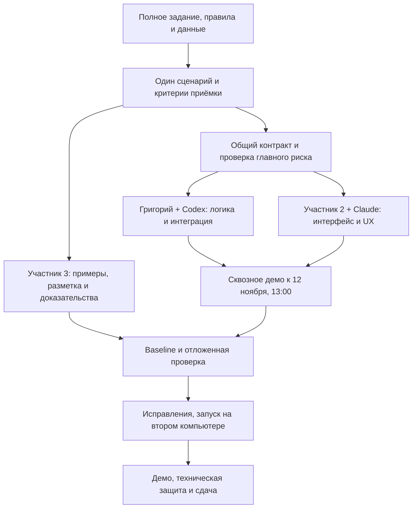

# Карта и план хакатона МФТИ · 10 ноября 2026

> **Актуализация 11 ноября:** получено полное условие. Оно требует одного резюме, набора вакансий и рейтинга вакансий; команда уточняет направление подбора. Также обязательны четыре статуса соответствия и Dockerfile (Compose для многокомпонентного решения). См. [разбор и вопросы](09-case-clarifications.md) и обновлённый [бриф](01-brief.md). Ниже сохранён предварительный план от 10 ноября: конечный MVP из одной пары и оценка 47 человеко-часов требуют пересмотра. Общие этапы полезны, но прежние предположения не заменяют полное условие.

**Цель:** сдать воспроизводимый инструмент для сопоставления резюме и вакансии, показать качество на отложенных примерах и защитить техническое решение.

**Подтверждено владельцем 10 ноября:** планируем трек №3; в команде трое, все работают. ChatGPT Pro — у Григория; Claude Max — у одного из сокомандников. Имена двух участников, их компетенции и часы ещё не сообщены. Роли, оценки времени и границы MVP ниже — предложение для согласования команды. Полное задание и рубрика жюри пока не получены.

Историческая интерактивная версия хранится только локально в artifacts и не входит в Git. Машиночитаемый список: [CSV](08-hackathon-backlog.csv). Актуальная работа команды — [план от 12 ноября](14-team-kickoff.md).

## 1. Факты и ближайшие действия

| Событие | Срок, МСК | Статус |
|---|---|---|
| Регистрация | **10 ноября, 23:59** | Срок подтверждён; регистрация участников неизвестна |
| Онлайн-открытие | 11 ноября, 17:00 | Подтверждено |
| Работа над кейсами | 12–13 ноября | Подтверждено |
| Внутренняя сдача команды | **14 ноября, 18:00** | Наш целевой срок |
| Официальная сдача | **14 ноября, 23:59** | Подтверждено |
| Очный финал | 15 ноября, ЦДП на Чистых прудах | Для приглашённых финалистов; время и длительность питча неизвестны |

Даты и краткое описание трека повторно прочитаны 10 ноября на [официальном сайте](https://hack80.phystech-union.org/). Часовой пояс и правило команды из 1–3 человек — из локального разбора положения от 9 ноября. Публичный сайт задаёт задачу трека: показать соответствие резюме требованиям вакансии и пробелы. Он не даёт полной рубрики оценки.

До закрытия регистрации каждый участник проверяет свою регистрацию и связь с командой на платформе. Получаем полное задание, данные, критерии, формат сдачи и правила готового кода. Отправка заявок и сообщений этим планом не выполнена.

## 2. Что перенесли из исследования

Прочитан [общий чат с исследованием](https://chatgpt.com/share/6af2fc5a-1da8-83eb-aa2e-d61fdc297a68). Опорные положения отдельно сверены с первоисточниками:

| Наблюдение | Как применяем в нашей команде |
|---|---|
| Medkit разделял независимые подсистемы по сессиям; Wrench Board начинал со спецификаций и планов | Две рабочие AI-сессии с разными зонами ответственности; общий контракт до разработки |
| ARIA планировал задачи и приёмку, MaestrIA проверял качество на размеченных случаях | Короткий бриф, владельцы задач, проверочный набор до улучшения модели |
| Судьи Devpost проверяют требования, работоспособность и ясность показа | Для каждого официального критерия готовим проверяемое доказательство |
| Победители Devpost рекомендуют ограниченный прототип и распределение работы по сильным сторонам | Один основной сценарий; функции P1 допускаются после работоспособного обязательного сценария и до заморозки функций |

Источники: [Anthropic — победители](https://claude.com/resources/articles/meet-the-winners-of-built-with-opus-4-7-claude-code-hackathon), [Devpost — судьи](https://info.devpost.com/blog/hackathon-judging-tips), [Devpost — участники](https://info.devpost.com/blog/tips-from-hackathon-winners). Это отдельные истории и советы, не причинное доказательство роста вероятности победы. Число агентов, график и нормы качества в нашем плане — собственные решения команды, а не требования организаторов.

## 3. Карта результата

Владелец итоговой сборки и отправки — предлагается Григорий. Участник 3 владеет проверкой и доказательствами; каждый разработчик сам проверяет свой код. Распределение пересмотреть при первом командном созвоне с учётом навыков.

## 4. Предлагаемый MVP трека №3

**Пользователь:** сотрудник отдела кадров. **Вход:** одна вакансия и одно резюме. **Результат:** таблица требований с подтверждающими фрагментами, противоречиями и отсутствующими сведениями; сотрудник проверяет выводы и принимает решение сам.

Предлагаемое отличие: любой положительный вывод можно проверить по исходному фрагменту. Недостаток информации показывается явно. Проверяем пользу такого подхода относительно простого baseline.

Основной путь:

1. Передать вакансию и резюме в формате, который требуется полным заданием.
2. Получить перечень требований и сопоставление с резюме.
3. Открыть исходный фрагмент для каждого подтверждённого соответствия.
4. Увидеть состояния «подтверждено», «противоречие» и «недостаточно данных», спорные места и вопросы для уточнения.
5. Проверить результат вручную. Если регламент требует балл или ранжирование, добавить прозрачный расчёт и его объяснение после согласования требований.

Минимальные условия приёмки, которые команда предлагает уточнить после получения задания:

- Полный путь проходит на втором компьютере по README.
- Ссылки на фрагменты ведут к существующему тексту; найденная цитата действительно обосновывает вывод по ручной проверке.
- Неизвестное не считается подтверждённым. Явное противоречие не теряется в среднем балле.
- Пустой, неподдерживаемый или повреждённый ввод и недоступность модели дают понятный результат без ложного успеха.
- Текст резюме рассматривается как данные: вложенные команды не меняют правила анализа.
- Анализ относится к профессиональным требованиям. Не используем пол, возраст, фото и другие чувствительные характеристики для оценки человека.
- Реальные вызовы, демонстрационные примеры и сохранённые результаты различимы. Метрики содержат методику и размер выборки.

По умолчанию вне P0: поиск кандидатов в HH, автоматическая рассылка, календарь собеседований, ATS/CRM, голосовые интервью, несколько вакансий за один запуск, сложная ролевая модель. Если полное задание требует что-либо из этого, обновить P0 и убрать равноценный объём другой работы.

## 5. Технический путь и Nanimai

Окончательный стек фиксируем после полного задания и проверки риска. Кандидат для узкого web/AI прототипа: Python/FastAPI для логики и React/TypeScript для интерфейса, если команда уверенно запускает их на обоих компьютерах. База данных нужна только при требовании хранить результаты. Это вариант архитектуры, а не уже выбранный или установленный стек приложения.

Доступ к модели внутри прототипа проверяем отдельно: предоставленный организаторами сервис или разрешённый доступ с известным бюджетом. Подписки для разработки сами по себе не подтверждают доступ приложения к API. Локальные агенты работают через собственные подписки участников; ключи и аккаунты между участниками не передаём.

Nanimai — возможный источник переиспользования. По локальному статическому аудиту есть серверные компоненты, но полного комплекта для запуска нет. Готовность работающего продукта и права на конкурсное использование не подтверждены.

**Решение T02, ограничение — два человеко-часа:** проверить допустимость готового кода, доступность компонентов и запуск нужного узкого пути. Если он не подтверждён, переходить к самостоятельному минимальному прототипу после разрешённого старта. Полную инфраструктуру Nanimai не ставить на критический путь. В сдаче раскрыть, что существовало до соревнования и что сделано командой во время него.

Основания находятся локально: `data/private/nanimai-review-2026-11-09/MIPT_CASE.md` и `REVIEW.md`. Эти материалы не публиковались и не передавались внешним сервисам при подготовке плана. Выводы аудита относятся к снимкам исходников, а не к проверенному production.

## 6. Команда, агенты и рабочие соглашения

| Владелец (предлагается) | Зона | Результат |
|---|---|---|
| Григорий + Codex | Логика, архитектурные решения, контракт, интеграция, отправка | Воспроизводимый основной сценарий |
| Участник 2 + Claude | Интерфейс, состояния ошибок, UX, запуск на второй машине | Пользователь самостоятельно проходит сценарий |
| Участник 3 | Условия и вопросы по кейсу, данные, разметка, измерения, демо | Проверяемые доказательства и комплект защиты |

Третий участник не получает автоматически доступ к чужой подписке. Если у него нет своего AI-инструмента, работа с требованиями, разметкой и проверкой остаётся самостоятельной полезной зоной.

1. Один репозиторий, отдельная локальная копия у каждого, небольшие ветки на задачи. Ветки Codex — с префиксом `codex/`.
2. После выбора стека закрепить владельцев каталогов. Общий контракт меняет интегратор по согласованию с потребителем. Каждый пакет изменений содержит критерий приёмки и команды проверки.
3. Каждые 60–90 минут: готово / дальше / блокер / что можно объединить. Блокер более 15 минут выносить команде с запасным вариантом.
4. Проверенные изменения объединять несколько раз в день; рабочий сценарий основной ветки сохранять.
5. На существенное изменение — одно независимое ревью. Повтор — после исправлений или при конкретном нерешённом риске. Проверка человеком не заменяет запуск сценария.
6. Codex: главный агент пишет код; один временный исследователь `gpt-6-luna / high` или ревьюер `gpt-6.1-sol / medium`, не более двух запусков помощников на ограниченную задачу. Они только читают, новых агентов не создают.
7. Claude: отдельная сессия на закреплённую область, короткие задания и точечная проверка. Настройку на компьютере сокомандника ещё надо проверить. Конкретные модели и лимиты он смотрит в своём аккаунте.
8. В начале рабочего блока записать остатки лимитов и ближайший сброс. При нехватке лимита уменьшить контекст/сложность задачи, переключить доступную модель в той же подписке или передать независимую задачу другому участнику. Платные дополнительные вызовы автоматически не включаем.

Навыки подключаются по задаче: `writing-plans`/`executing-plans` — после принятия конкретного плана реализации; `systematic-debugging` — при воспроизводимом сбое; `requesting-code-review` — для существенного изменения; `verification-before-completion` — перед заявлением о готовности. Правила проекта по числу и правам агентов приоритетны. Новые навыки ради этой карты не устанавливались.

## 7. Календарный план

Все внутренние часы — предлагаемые контрольные точки, МСК. Реальное время доступности нужно согласовать.

| Когда | Григорий + Codex | Участник 2 + Claude | Участник 3 | Условие выхода |
|---|---|---|---|---|
| 10 ноября | Доступы к репозиторию и запуск инструментов | Проверить Claude Code по своей подписке | Проверить регистрацию всех и собрать документы | Команда зарегистрирована; доступы проверены |
| 11 ноября, 17:00–18:00 | Совместно: открытие, полное задание, критерии и границы MVP | Совместно | Вести бриф и список вопросов | G0: правила и требования известны |
| 11 ноября, 18:00–21:00 | T02: главный риск и решение по Nanimai; T03: контракт | Макет одного сценария и согласование контракта | Черновая разметка примеров, вопросы по требованиям | G1: есть контракт и проверенный технический путь |
| 12 ноября, 10:00–13:00 | Основная логика и соединение частей | Интерфейс сквозного сценария | Проверочные примеры и воспроизведение | G2: вход → реальный анализ → результат |
| 12 ноября, 13:00–18:00 | Исправить основные отказы | Понятные результаты и ошибки | Baseline, первые замеры, уточнения заказчика | Работает P0, известны конкретные дефекты |
| 13 ноября, 10:00–18:00 | Надёжность, одно ревью, исправления | UX и воспроизводимость запуска | Отложенная проверка и таблица доказательств | G3: замеры сохранены; **18:00 — заморозка функций** |
| 14 ноября, 10:00–13:00 | Проверить итоговую сборку | Чистый запуск на втором компьютере | Проверить ссылки, критерии и комплект сдачи | G4: другой участник повторяет результат по README |
| 14 ноября, 13:00–18:00 | Техническая часть защиты и отправка | Демо и резервная запись | Слайды, методика, две репетиции | G5: **сдано к 18:00**, сохранено подтверждение |
| 14 ноября, 18:00–23:59 | Резерв на исправление проблем сдачи | Резерв | Резерв | Официальный дедлайн 23:59 |
| 15 ноября | Очная защита при приглашении | Поддержка демо | Ответы по метрикам и ограничениям | Длительность выступления уточняется |

**Расчёт ёмкости, не обещание команды:** 4 часа на человека вечером 11 ноября и по 6 часов 12–14 ноября = 66 человеко-часов. P0 в CSV = 47 человеко-часов, резерв = 19 (29%). Григорий — 18 часов, участник 2 — 14,5, участник 3 — 14,5. В совместных задачах часы поделены между участниками; час одновременной репетиции троих считается тремя человеко-часами. Подготовка 10 ноября и финал 15 ноября в этот бюджет не входят.

Если фактическая ёмкость меньше 66 часов, пересчитать объём до начала реализации. Сначала убрать P1; затем упростить форматы, экраны и интеграции, сохранив обязательные требования, реальные проверки и сдачу. Сон и перерывы остаются в расписании.

## 8. Проверка AI и доказательства для жюри

Предлагаемый набор — **20 пар «вакансия–резюме»**, минимум 10 при ограниченном времени. Он ещё не создан. Предпочесть данные организаторов; самостоятельно созданные случаи помечать как синтетические. Половина — для разработки, половина — для отложенной проверки. Сохранять источник, идентификатор и ожидаемые выводы по каждому требованию. Разметку готовит участник 3; спорные примеры проверяет второй человек.

Нужны обычные соответствия, синонимы навыков, отсутствие сведений, явное противоречие, неоднозначный стаж, нерелевантный опыт, повреждённый ввод и инструкция внутри резюме. Личные и чувствительные сведения не нужны для этих опытов.

Baseline — простой поиск явных терминов требований в тексте резюме. Его ограничения описать. Сравнение вести на одних и тех же случаях и критериях. После просмотра отложенной части не подстраивать под неё систему, продолжая называть её независимой проверкой.

| Проверяем | Как считаем | Что показываем |
|---|---|---|
| Подтверждённые соответствия | Число корректных положительных выводов / все положительные выводы | Числитель, знаменатель, ошибки |
| Покрытие требований | Число требований, для которых есть явный результат / число размеченных требований | Пропуски и дубли |
| Обоснованность | Доля выводов с корректным исходным фрагментом; точность цитаты проверять отдельно от смысла | Пара «вывод → источник» |
| Неопределённость | Отдельная таблица ошибок для «нет данных» и «противоречие» | Где система ошибочно уверена |
| Время | Замер полного пути на одних данных; медиана, максимум, число запусков | Результат с моделью и условиями замера |
| Пользовательская польза | Сравнить ручную проверку и работу с прототипом, если есть доступный проверяющий | Малый эксперимент с честным размером выборки |

Это внутренние критерии, не официальные веса жюри и не уже полученные результаты. Не обещаем заранее процент качества или экономии времени. Маленькая синтетическая выборка не подтверждает качество на реальном найме. Если система уступает baseline по части случаев, показать это и причину.

После получения рубрики заполнить в `docs/01-brief.md`: дословный критерий → вес → функция/замер → файл или экран → ответственный. Для технической защиты подготовить схему потока данных, алгоритм обработки неопределённости, методику eval, ограничения и пример сбоя.

## 9. Демо и сдача

До уточнения регламента готовим модульное трёхминутное демо: 20 секунд — проблема; 80 — основной путь и проверка вывода по источнику; 35 — сложный случай и замеры; 30 — техническая схема; 15 — ограничения и следующий шаг. Это внутренний формат, а не объявленный лимит выступления.

В комплект: рабочий прототип/ссылка в требуемом формате, README, список зависимостей и версии, примеры без персональных данных, результаты проверок, схема, презентация при необходимости, резервное видео и перечень переиспользованных компонентов. Окончательный список сверяется с платформой.

Состояния задач в CSV при создании — «Запланировано». Никакая реализация, регистрация, отправка или измерение не считается выполненной от наличия плана. Фактические проверки записываем в `docs/04-quality.md`.

## 10. Когда сокращаем объём

| Сигнал | Действие |
|---|---|
| За T02 не подтверждены права/работающий путь Nanimai | Самостоятельный узкий прототип; существующий код не переносим до подтверждения |
| Доступ к runtime-модели не работает | Проверить предоставленный организаторами или иной разрешённый путь; явно отделить baseline от демонстрационной заглушки |
| К 12 ноября, 13:00 нет сквозного пути | Остановить P1; совместно собрать один обязательный формат и один экран результата |
| Разметка неоднозначна | Уточнить определения и хранить разногласия; не считать спорные случаи доказанным успехом |
| 13 ноября, 18:00 остались крупные дефекты | Заморозить функции и исправлять блокирующие ошибки |
| 14 ноября воспроизводимость не подтверждена | Приоритет запуску и комплекту сдачи; резервная запись не выдаётся за живую интеграцию |

## 11. Что остаётся уточнить

- Подтверждение регистрации всех троих и оформления команды.
- Имена, навыки, реальные часы и принятие предложенных ролей.
- Полный кейс, данные, критерии и веса, форматы ввода и сдачи, продолжительность защиты.
- Права и правила переиспользования Nanimai, минимальный доступный комплект.
- Доступ к runtime-модели, бюджет и разрешённое место обработки данных.

До этого момента подготовлены только план и рабочие материалы. Разработка приложения и установка предметных зависимостей не начаты.
