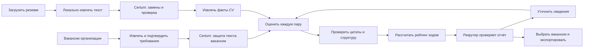
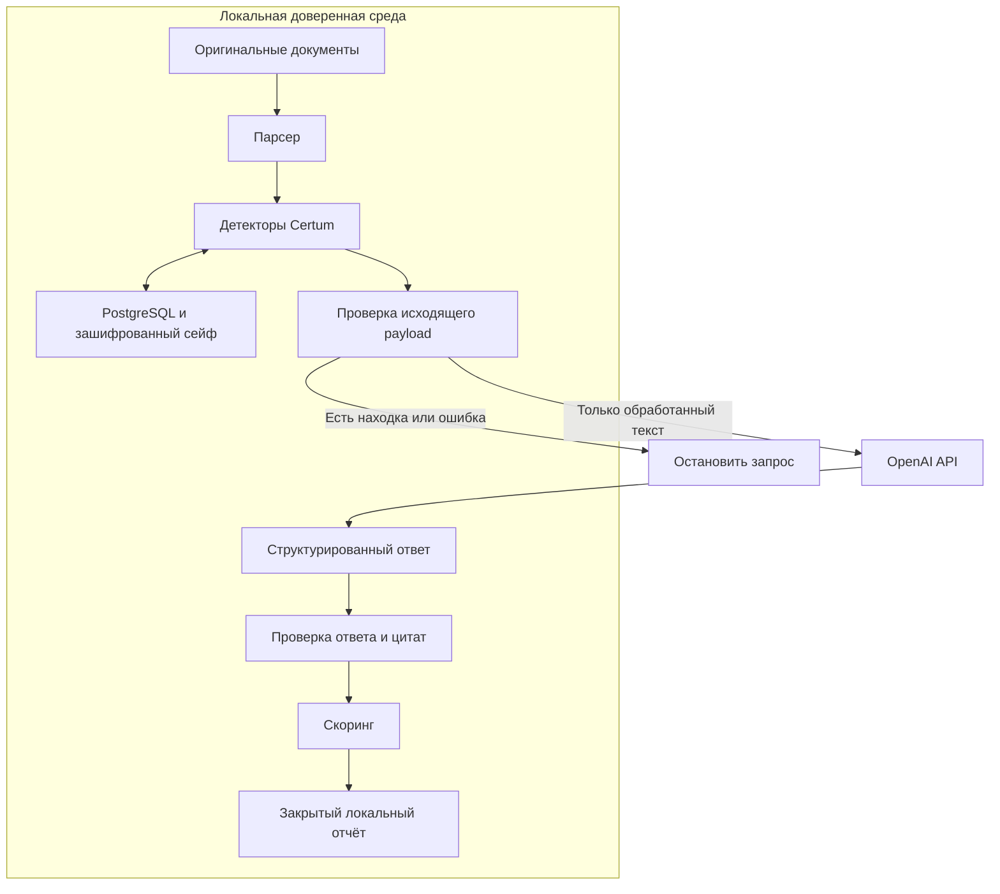

# Архитектура AI-рекрутера МФТИ

Версия 0.1 от 12 ноября 2026. Владелец решений — Григорий. Подтверждённые требования: [ответы эксперта](12-expert-answers.md). Этот документ определяет целевой продукт и первый технический срез; раздел «Статус» отделяет их. Формула — проверяемая гипотеза команды, не утверждённая заказчиком методика.

## 1. Продукт и границы

Инструмент рекрутера: загрузить одно резюме, увидеть подходящие открытые вакансии и проверить основание каждой рекомендации. Результат по каждой вакансии: таблица требований, подтверждения из CV, четыре статуса, комментарии, сильные стороны, пробелы, риски и вопросы кандидату. Рекрутер выбирает, кому передать результат. Нанимающий менеджер получает отчёт, собственного рабочего кабинета в первом срезе нет.

Сохраняем методологию Nanimai: структурирование требований, проверка отдельных критериев, доказательства, объяснимый расчёт. Меняем направление: **резюме → все выбранные активные вакансии**. Не переносим весь Nanimai Platform с отсутствующими внутренними сервисами. Дополнительных комплектов кода не будет.

Первая поставка к консультации: CLI и файлы отчёта. Целевой конкурсный MVP: тот же движок за простым локальным веб-экраном, если после проверки качества останется время; Docker и документация к финальной сдаче обязательны по условию. HH, поиск кандидатов, автоматическая рассылка, кабинет соискателя, обучение модели, автономные агентные переговоры и ZIP-импорт не входят в P0.

## 2. Золотой сценарий рекрутера

1. Рекрутер заводит вакансии организации, добавляет текст или документ.
2. Система извлекает требования. Рекрутер один раз проверяет обязательность и веса, сохраняет версию. В CLI этой формы пока нет: обязательность предлагается по явной цитате, веса фиксированы и помечены как черновые.
3. Рекрутер добавляет CV в общую входящую папку кандидатов.
4. Система проверяет формат и извлекает текст локально; оригинал не передаёт модели.
5. Защита Глеба заменяет найденные личные значения ссылками. Повторная проверка обязательна перед отправкой.
6. Модель извлекает факты CV и сравнивает их с каждой выбранной вакансией.
7. Код проверяет структуру, цитаты, полноту строк, ссылки на факты; рассчитывает рейтинг.
8. Рекрутер видит порядок вакансий, основания, неизвестные сведения и возможные препятствия.
9. Открывает подробный отчёт, уточняет вопросы кандидату и при необходимости вносит подтверждённые исправления.
10. Выбирает одну или несколько вакансий и сохраняет/экспортирует отчёт для менеджера.

Автоматический анализ не означает автоматическое назначение кандидата на top-N вакансий. В целевой модели связи кандидат–вакансия сохраняются отдельно: не создаём копию человека для каждой вакансии. Решение о передаче и отказе остаётся у рекрутера.

## 3. Технические компоненты

| Компонент | Первый CLI | Целевой MVP | Зачем |
|---|---|---|---|
| Вход | `python -m prototype` | FastAPI + простая HTML-форма/таблица | Один движок, минимум интерфейсного кода |
| Парсинг | txt/md, pdfplumber, python-docx | Те же функции; очередь для нескольких файлов при необходимости | Текст не покидает локальную среду при чтении |
| Схемы | Pydantic 2 | Версионированные контракты API и хранения | Отклонять неверные ответы |
| Приватность | Адаптер реального Certum core | Тот же core и PostgreSQL с tenant/vault | Сохранять оригинальные значения отдельно от контекста LLM |
| LLM | OpenAI Responses + Structured Outputs | Та же интеграция | Luna по умолчанию, Sol выбирается явно |
| Оценка | Python, детерминированная формула | Тот же модуль | Числа воспроизводимы и не придумываются моделью |
| Хранение приложения | Каталог локальных JSON/CSV/MD | SQLite + закрытый каталог файлов для одного локального развёртывания | Не нужны Mongo, Redis, RabbitMQ и S3 на первом этапе |
| Параллелизм | Последовательно | Ограниченная фоновая очередь, только если требуется | Контроль стоимости и простая диагностика |
| Упаковка | venv + requirements | Dockerfile; Compose, если приложение + PostgreSQL Certum | Выполнить требования сдачи |

Python 3.12 — общая целевая версия, потому что изученный Certum core требует >=3.12,<3.13. CLI без core сейчас можно запускать на Python 3.13. UI/SQLite/FastAPI в текущем коде ещё отсутствуют. React не обязателен для простого конкурсного экрана; решение прежнего v0.2 о React заменено этим упрощением.

## 4. Граница данных

**Что берём у Глеба:** `build_detectors(build_entities(build_vault(settings)))`, `Detectors.redact`, `Detectors.scan`, `tenant_scope`. Изучен certum-assistant в certum-demo, ревизия начинается с `156c229`. Это другой код, чем одноимённый TS-проект Certum. Полный исходник и личная инфраструктура Глеба не копируются в публичный репозиторий.

**Уточнение владельца 13 ноября:** нужна технология защиты как встроенный локальный модуль нашего продукта. Приложение Certum, его интерфейс и подключение к чужому развёрнутому сервису не входят в решение. Ссылка/путь к Certum фиксирует источник и версию core. Отдельные локальные модели, БД замен и tenant/vault нужны выбранной реализации core, а не доступу к чужому продукту или личным данным.

**Что требуется для настоящего подключения:** Python 3.12, зависимости core, локальные модели Slovnet/Navec, мигрированный PostgreSQL, роль приложения, отдельный tenant, мастер-ключ и зашифрованный ключ tenant. CLI не создаёт автоматически базу/tenant и не читает `.env` core. Переменные перечислены в prototype/.env.example. Ключи передаются окружением; не в чат, код или аргументы команды.

У прототипа проверка строже `is_definite` из core: оставшаяся находка любого типа останавливает передачу. Сырые токены вида `слово#число` отклоняются до детектора: core считает их защищёнными ссылками, что могло скрыть личное значение. После обработки допускаются только ссылки, действительно выпущенные детектором в этом запуске. Это дополнительная проверка входа, не замена PII-детекторов. Она может блокировать безобидное `C#3`; такой случай требует разбирательства, а не выключения защиты. Если core не установлен, моделей нет или база недоступна — реальный запуск завершается до модели.

**Ограничение:** замена ФИО и телефона — псевдонимизация, не доказательство полной анонимности. Редкая карьера, даты, публикации и сочетания фактов могут идентифицировать человека. Перед реальным внешним прогоном нужно проверить разрешённый состав данных и качество защиты на типичных документах. Оценка этой границы остаётся P0 Григория, не скрытая задача Егора. `store=False` уменьшает сохранение объектов Responses, но не означает обещание отсутствия любых журналов провайдера. Никакого юридического заключения о допустимости обработки прототип не даёт.

Для демонстрации без защиты разрешён только встроенный явно вымышленный набор без личности. Нет CLI-флага «считать любой файл синтетическим». Реальные резюме не давать и агентам разработки; их подписочный чат тоже внешняя модель.

## 5. Пайплайн оценки

| Этап | Вход | Выход | Проверка |
|---|---|---|---|
| Чтение | CV + до 20 документов вакансий | Нормализованный текст | Формат, размер <=5 MB, <=60 000 символов, PDF <=100 страниц |
| Защита | Все тексты | Текст со ссылками Certum | Все документы проходят до первого вызова LLM |
| CV facts | Обработанный CV | `Facts.items[{id,text,quote}]` | Уникальные id, точное вхождение quote |
| Requirements | Одна обработанная вакансия | `Requirements.items[{id,text,quote,mandatory_quote}]` | Непустой список, уникальные id, точные цитаты |
| Match | Требования + факты | `Evaluation.rows[{requirement_id,status,fact_ids,comment,question}]` | Ровно одна строка на требование, известные fact_ids |
| Score | Проверенные строки + требования | L, H, coverage, mandatory, policy_version | Код без LLM |
| Rank | Все успешно оценённые вакансии | Порядок и recommendation | Полнота набора отделена от соответствия |
| Export | Проверенный результат | JSON, CSV, Markdown | Без имён исходных файлов в payload; права файлов 600 |

Точные Pydantic-схемы: prototype/contracts.py. Сканирование выполняется и перед каждым модельным запросом, включая ранее сгенерированные поля, и после каждого ответа. Текст документов считается данными, команды внутри них не исполняются. У модели нет инструментов, браузера или права записывать файлы.

Дополнение 13 ноября по ревью Егора: mandatory_quote должна включать quote своего требования целиком и содержать минимум 8 символов. Заголовок обязательности цитируется непрерывным фрагментом вместе с требованием. Точные дубли пары text+quote отклоняются. Эта проверка связывает цитаты структурно, но не доказывает, что текст действительно делает требование обязательным, и не обнаруживает все парафразы-дубли.

Точная цитата подтверждает наличие фрагмента, но **не доказывает корректность интерпретации**. Например, «читал о Python» не равно опыту разработки. Это проверяется качеством промпта и оценкой результатов человеком. Нет валидатора, который магически устраняет смысловые ошибки. Поскольку сравнение использует извлечённые факты, пропуск на извлечении может вызвать лишний unknown — это отдельная метрика качества.

## 6. Четыре статуса и скоринг

| Статус | Значение | Доказательство |
|---|---|---|
| full | Требование подтверждено полностью | Одна или несколько цитат фактов |
| partial | Подтверждена часть требования | Цитаты и пояснение, чего не хватает |
| fail | Есть явный факт несоответствия | Например, указан 1 год при обязательных 3 |
| unknown | Сведений не обнаружено | Нет утверждения об отсутствии навыка, есть вопрос |

Черновые веса: 3 для явно обязательного требования, 1 для остальных. Обязательность требует отдельной цитаты; модель не получает права домыслить её по престижу навыка. Рекрутер должен подтвердить её в целевом UI. Полнота=1, частичность=0.5, несоответствие=0. Unknown учитываем отдельно.

При общей сумме весов W, известном весе K и сумме подтверждённых баллов P:

- `L = 100 × P / W` — подтверждённая часть оценки.
- `H = 100 × (P + W − K) / W` — верхняя граница, если неизвестные требования подтвердятся.
- `coverage = 100 × K / W` — доля требований с определённым статусом.

Это не вероятность трудоустройства и не статистический доверительный интервал. Граница H не переоценивает partial: частичность уже является известным результатом по выбранной политике. При нулевом W оценка не формируется.

Пример: обязательный Python full (вес 3), желательный SQL unknown (вес 1) → L=75, H=100, coverage=75. Если SQL fail, L=75, H=75, coverage=100. Число L совпадает, но вывод и вопросы различаются.

Обязательные критерии отдельно: `violated` при подтверждённом fail; `clarify` при partial/unknown; `confirmed`, если все full; `not_set`, если обязательность не задана. Не вычитаем дополнительный штраф за тот же критерий.

Порядок: сначала вакансии без выявленного моделью нарушения обязательного критерия, затем по L. Равные результаты имеют одинаковое место; id нужен только для стабильного отображения. `review_top` — предложение рекрутеру посмотреть верхние позиции, не утверждение «кандидат годен». `clarify` — открытые обязательные сведения в любой вакансии на первом месте либо отсутствие подтверждённого соответствия. `review_none_fit` — весь набор обработан и модель указала нарушение обязательного критерия у каждой вакансии; рекрутер должен проверить обязательность и смысл доказательств. **CLI не выдаёт окончательный none_fit:** дословность цитаты не доказывает правильность интерпретации. После проверки человек может сформулировать разрешённый экспертом вывод. `incomplete` — ошибки/необработанные позиции. Все рекомендации имеют requires_human_review=true.

## 7. Хранение, версии и связи в целевом MVP

| Сущность | Главное содержимое |
|---|---|
| Organization | Граница доступа; в локальном MVP одна организация |
| Candidate | Локальный id; личные поля отдельно от модельных фактов |
| ResumeVersion | candidate_id, hash, версия парсера, ссылка на закрытый оригинал |
| VacancyVersion | vacancy_id, active, требования, подтверждённые веса и обязательность |
| AnalysisRun | версии CV/вакансий/политики/промпта, модель, состояние, usage, время |
| PairEvaluation | run_id, vacancy_version_id, статусы и ссылки на доказательства |
| CandidateVacancy | Выбранная рекрутером связь; не клон кандидата |
| Report | Снимок результата конкретного запуска, не постоянно меняющаяся ссылка |

Сейчас в отчёте есть schema_version, policy_version и хеши обработанного текста; полноценной БД и версий промпта ещё нет. До сравнения моделей нужно добавить prompt_version и сохранить повторяемый набор входов. У каждой новой версии вакансии новый анализ; прежний отчёт не переписывается. После уточнения кандидата создаём новую версию фактов с источником уточнения и временем, не выдаём слова рекрутера за цитату старого CV.

Не использовать общий кэш по сырому тексту между организациями. В перспективе ключ кэша: tenant + hash обработанного документа + model + prompt_version + schema_version + policy_version. В P0 кэша нет. Не логировать сырой payload, имена файлов, PII, секреты или tracebacks сторонних клиентов. Ошибки сохранять кодом и стадией. Файлы и БД не публиковать в Git.

Пока приложение локальное и без аккаунтов, не открывать его в интернет. Перед общим веб-доступом: аутентификация, проверка принадлежности каждого CV/job/run tenant при чтении/изменении/удалении, закрытые файлы, ограничения загрузок, политика удаления. Наличие RLS в Certum не заменяет проверки доступа в приложении.

## 8. Ошибки и устойчивость

| Ситуация | Требуемое поведение / текущий статус |
|---|---|
| PDF-скан/пустая страница | Явная ошибка, без скрытой передачи в OCR-сервис; OCR отложен |
| Повреждённый/огромный файл | Отказ локально, без сетевого запроса |
| Certum не готов/остаточные находки | Остановка до модели, без обхода |
| Нет ключа | Локальное replay работает; live останавливается |
| API timeout/429/отказ/обрезанный ответ | Нет автоповторов; ошибка и остановка следующих вызовов |
| Выдуманная цитата/пропущенное требование | Пара отклоняется, не превращается в unknown |
| Одна вакансия не оценена | Частичный отчёт + incomplete; следующие позиции отмечены необработанными |
| Все обязательные данные неизвестны | Уточнение, не автоматический отказ |
| Пустой набор вакансий | Ошибка входа |
| Смена модели/весов | Новый запуск; результаты не смешивать |

Текущий CLI читает все входные файлы до первой отправки; повреждённый вход прекращает запуск целиком. Ошибка после нескольких оценок сохраняет частичный рейтинг. Возобновление по контрольной точке и пакет по нескольким CV — задачи после первого среза. Скрывать реальную стоимость неуспешных вызовов нельзя: reservation остаётся занятым.

С 13 ноября сбой извлечения/валидации facts после защиты сохраняет пустой incomplete-отчёт со всеми неоценёнными вакансиями. Невалидные факты в него не попадают. Ошибки требований и оценки имеют отдельные стадии запроса и валидации; следующего вызова после сбоя нет. Ошибки входа и первичной защиты по-прежнему прерывают запуск до отчёта.

## 9. Бюджет и модели

Общий доступный баланс со слов владельца — $74. Стандартный лимит CLI — консервативный резерв $1 на один процесс, допустимый явный максимум $5. Не расходуем весь баланс автоматически. Вызовы последовательные, максимум 50, SDK retries=0, timeout=90s. Лимит локальный: три одновременно запущенных процесса не делят единый счётчик. До массовых прогонов установить общий контроль расходов и выделить одному человеку роль запускающего.

Luna — стартовая модель; Sol — явно выбранный сравнительный прогон на тех же данных. Не предполагаем превосходство без проверки. Числовой скоринг один и тот же для обеих. В первом пути один facts-вызов + два на каждую вакансию. Для трёх вакансий — семь вызовов при успехе.

Расчёт резерва использует байтовую верхнюю оценку входа с запасом, лимит выходных токенов и тарифы, записанные на 12 ноября; это предохранитель, не гарантированный биллинг провайдера. Фактические токены сохраняются из usage. Тарифы перед массовым запуском сверить: [Luna](https://developers.openai.com/api/docs/models/gpt-6-luna), [Sol](https://developers.openai.com/api/docs/models/gpt-6.1-sol). Доступность моделей на API-аккаунте ещё не проверена. [Structured Outputs](https://developers.openai.com/api/docs/guides/structured-outputs).

Подписочные агенты разработки отдельно: Григорий/Codex — интеграция; Егор/Claude с Opus — продукт и сложное ревью; Ваня/Codex — выделенная часть разработки. Они не являются агентами рантайма AI-рекрутера. LangGraph/CrewAI и другие оркестраторы для этого последовательного пути не требуются.

## 10. Статус реализации и приёмка

**Реализовано в первом CLI:** схемы, четыре статуса, проверка цитат/ссылок, формула и рейтинг, локальный парсинг, ограничение затрат, код адаптера Certum, код вызовов OpenAI, отчёты и встроенный synthetic replay.

**Проверено локально:** см. актуальный журнал в docs/04-quality.md. Replay подтверждает связность и правила, не качество LLM. Отсутствие ключа — известное состояние, владелец добавит его позже.

**Проверено отдельно 13 ноября:** live Luna на встроенном вымышленном примере (3 вакансии, 7 запросов); настоящий адаптер Certum с отдельным PostgreSQL/vault/NER в Python 3.12 на синтетических контактах; Docker автономного replay на Linux arm64. **Не проверено end-to-end:** совместный Certum → OpenAI, качество на четырёх CV × трёх вакансиях, запуск на ноутбуках ребят. Сравнение Luna/Sol и ручная проверка качества не подменяются этими smoke. Подробности и расходы — docs/04-quality.md.

**Следующая поставка:** проверить закреплённые зависимости на втором компьютере; подготовить Certum локально; synthetic live; защищённый прогон разрешённых данных; prompt_version и метрики; затем минимальный экран, SQLite при необходимости, Docker и README финальной сдачи.

Приёмка прототипа: одна команда; все вакансии имеют результат или явную ошибку; каждое требование учтено один раз; цитаты существуют; unknown отличается от fail; none_fit не возникает при неполных данных; расходы и режим реальны; нет молчаливых заглушек.

Качество измеряем отдельно: доля извлечённых требований/фактов, корректность статусов, доля доказательных обоснований, согласованность порядка с экспертным разбором, время, стоимость, число privacy-блокировок. Четыре CV — малый набор; это не основание объявлять универсальную точность. Ответы второй модели не являются независимой эталонной разметкой.

## 11. Что уточнить на консультации

1. Какие требования действительно запрещают рекомендацию при несоответствии, а где возможен компромисс? Попросить один пример.
2. Как ожидается ранжировать сильного кандидата с недостающими сведениями против более слабого, но полностью описанного? Показать наш L/H и отдельный coverage.
3. Как проверяют порядок вакансий и обоснования на скрытом наборе: экспертно, по эталону или комбинированно?
4. Какие сведения можно передавать внешней модели после обработки и есть ли требование полностью локального исполнения?
5. Какой минимальный экспорт менеджеру достаточен и что обязательно показать на защите?

Не тратим консультацию на уже подтверждённые вопросы: пользователь — рекрутер, направление — вакансии для CV, четыре статуса обязательны, обоснованное none_fit допустимо.

## 12. Контракт будущего веб-слоя — пока не реализован

Эти маршруты — проект интерфейса поверх существующих функций, а не обещание работающего API. В первом локальном приложении одна организация; любое расширение на несколько требует tenant-проверок на каждом запросе.

| Маршрут | Действие | Основная проверка |
|---|---|---|
| POST /vacancies | Добавить документ/текст вакансии, извлечь черновик требований | Размер/формат, privacy, непустые требования |
| PATCH /vacancies/{id}/requirements | Подтвердить требования, веса и обязательность | Новая версия, положительные веса, принадлежность |
| POST /resumes | Загрузить CV в общую входящую папку | Закрытое хранение, формат, новая версия |
| POST /analyses | Начать анализ resume_version_id + vacancy_version_ids | Только активные/доступные вакансии; лимит бюджета |
| GET /analyses/{id} | Состояние, прогресс и результат | Не выдавать промежуточный результат за полный |
| GET /analyses/{id}/report | Экспорт снимка | Проверка доступа; буквальный вывод недоверенного текста |
| POST /candidate-vacancies | Сохранить выбор рекрутера | Отдельная связь, без дублирования CV |

Состояния: queued → parsing → protecting → extracting → matching → validating → completed. Ответвления failed, partial, cancelled. Прогресс: обработано вакансий / всего; состояние приватности и стадия ошибки без исходных значений. Повторная отправка формы с тем же idempotency key возвращает существующий запуск, а не тратит деньги повторно. Эти механизмы отсутствуют в CLI и должны быть реализованы до многопользовательского/фонового режима.

Порядок зависимостей при сборке: подтверждённые схемы → локальный движок → защита и реальный API → проверка качества → обёртка API → минимальный экран → упаковка. Если время ограничено, сокращаем интерфейс, а не проверки цитат/приватности. Перед сдачей запуск из чистого окружения, две демонстрации с ожидаемым поведением, фиксация расходов/времени и список известных ограничений.
