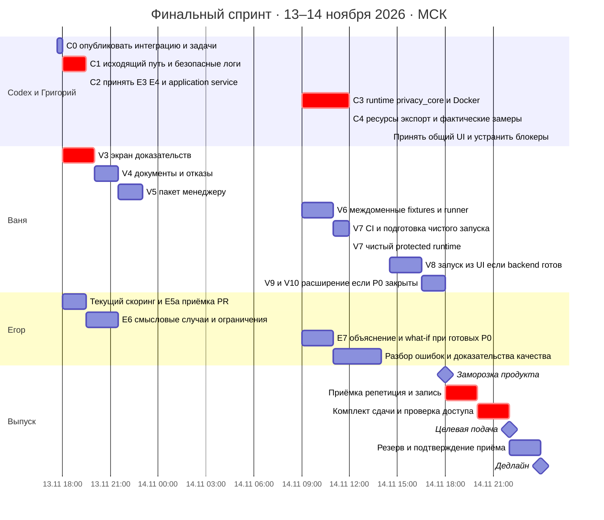
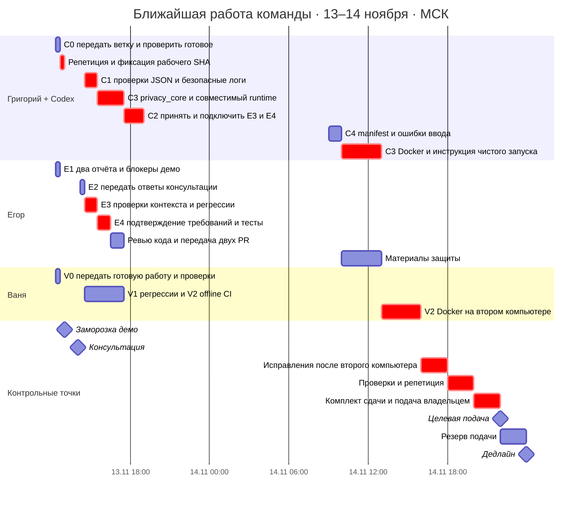
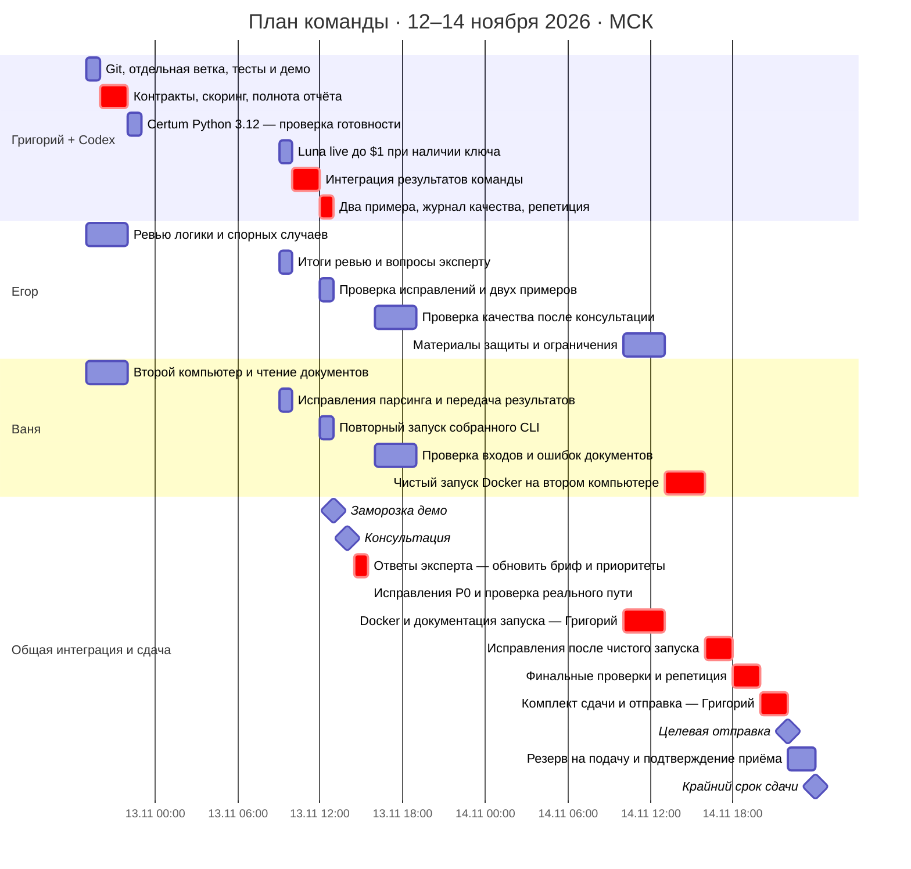

# План работы до сдачи

## Финальный спринт — обновление 13 ноября, 17:40 МСК

Этот график заменяет утренние интервалы ниже. Время — рабочий ориентир, доступность людей и длительность сложных исправлений не подтверждены. Ночью обязательная работа не запланирована. [Приоритеты и условия сокращения](20-final-product-plan.md); первые рабочие PR сдаём независимо, не ждём завершения всего пакета.

V8 зависит от C2/C3; V9 — от E7. Если зависимость задержана, сдаётся офлайн viewer с настоящими сохранёнными результатами, без заявления о работающем запуске из браузера. P0 защиты/доказательств/чистого Docker остаются обязательными. Сокращение: сначала убрать what-if/декоративную доводку, затем необязательный новый способ запуска, а не скрывать незакрытые критерии.

## История планов до финального спринта

## Актуальный план после ревью — обновлён 13 ноября, 12:20 МСК

Назначения, зависимости и приёмка — [docs/18-next-actions.md](18-next-actions.md). Все интервалы ниже — план, не измеренная длительность или обещание готовности. До новых изменений Ваня передаёт уже готовую ветку, Codex публикует свою интеграцию. Объём защищённого запуска зависит от C1/C3 и согласованного отдельного бюджета; повторный API-вызов этим графиком не разрешается.

C5 (установщик агентов) выполняется после продуктовых блокеров и отдельно от замороженного демо. При нехватке времени его перенос не должен задерживать защиту данных или воспроизводимый запуск. Обнаруженные ошибки не считаются исправленными по наличию строки в графике.

## Исходный план 12 ноября и история статусов

Составлен 12 ноября 2026, 18:45 МСК. Все часы — МСК. Интервалы ниже — предложение по планированию, а не подтверждённая доступность участников или оценка фактически выполненной работы. Основание: README.md, 14-team-kickoff.md, 15-architecture.md, 12-expert-answers.md, 01-brief.md и поручение владельца.

Контрольные сроки: заморозка демонстрации 13 ноября в 13:00; консультация 13 ноября в 14:00; финальная сдача 14 ноября в 23:59. Цель команды — отправить результат до 22:00 и сохранить запас на проблемы с подачей.

## Зависимости и условия

- Интеграция 13 ноября в 10:00 зависит от проверки контрактов и результатов Егора и Вани. Результат каждого: файлы/ветка, команды, фактические проверки и ограничения.
- К 13:00 нужны успешный и спорный примеры; четыре статуса, объяснение порядка вакансий, явный incomplete. Проверки и точные команды записываются в docs/04-quality.md.
- Утренний слот Luna — условный: только после локального добавления ключа, на встроенных синтетических данных, с лимитом $1. Sol — только отдельное сравнение при необходимости, вне обязательного плана.
- Слот Certum ограничивает время диагностики, но не обещает готовую интеграцию. Проверить настоящий core, модели, PostgreSQL/tenant/vault в Python 3.12; при недоступности записать конкретный блокер. Защиту не обходить.
- Если live к заморозке не проверен, показывать synthetic replay с явной пометкой. Это резерв для демонстрации, не доказательство выполнения требований к реальной интеграции на финале.
- Реальные резюме во внешний API не отправлять. После консультации проверять реальный путь на синтетике; другие данные требуют отдельного разрешения и рабочей защиты.
- Docker готовит Григорий/Codex; Ваня проверяет на втором компьютере. README содержит запуск/остановку, настройки и внешние сервисы; Compose нужен для многокомпонентного решения. В комплекте минимум два use case с ожидаемыми результатами, архитектура и известные ограничения.
- UI — только при запасе времени после P0; он не должен сдвигать Docker, проверку качества и сдачу. Ночные часы не запланированы как обязательная работа.
- Канал подачи и доступ жюри проверить заранее в рамках подготовки консультации; перед финалом перепроверить. Отправляет владелец или агент по отдельному явному поручению. Завершение — подтверждение принятой отправки.

Этот документ — план, не журнал выполнения. Реальный статус работ хранится в docs/04-quality.md.

## Обновление 13 ноября — после ревью Егора

- Ревью Егора получено в PR #2; его три файла перенесены в docs/reviews без изменения текста. PR автоматически не сливался.
- В отдельной интеграционной ветке готовы два replay-примера. Исправления по п. 1, 4, 5 и точным дублям требований проверены локально; смысловые ошибки п. 2 и решение о формуле п. 3 остаются открытыми.
- Dockerfile автономного CLI подготовлен; контейнер не проверен. Docker daemon недоступен, запуск OrbStack вернул kLSNoExecutableErr. Проверка на втором компьютере остаётся задачей Вани.
- От Григория: локальный API-ключ и ответы эксперта после консультации. От Вани: результаты парсинга и чистого запуска. Техническую настройку Certum ведёт интеграция; если есть уже готовый отдельный тестовый стенд Глеба, нужен путь к его инструкции, не секреты в чате.

### Фактический прогресс к ночи 13 ноября

- Ключ добавлен локально. Live Luna на встроенной синтетике прошёл: 3/3, 7 запросов, ~$0.00083 по стандартному тарифу. Дополнительного платного сравнения не было.
- Docker разблокирован запуском OrbStack вне песочницы. Образ собран, состав проверен, оба replay прошли без сети. Ранний Docker-блокер выше снят; до 14 ноября остаётся упаковка защищённого пути и второй компьютер.
- Поднят отдельный Certum: Python 3.12, core lock, PostgreSQL/tenant/vault, NER. Реальный privacy smoke прошёл, общий Certum → OpenAI ещё не проверен.
- В GitHub найдены только PR #1 и #2, ветки Вани/парсинга пока нет. Проверка второго компьютера и документов остаётся его первой задачей после передачи интеграционной ветки.
- Новых ответов эксперта нет. Формула не менялась; смысловая обязательность и релевантность цитат остаются рисками.
