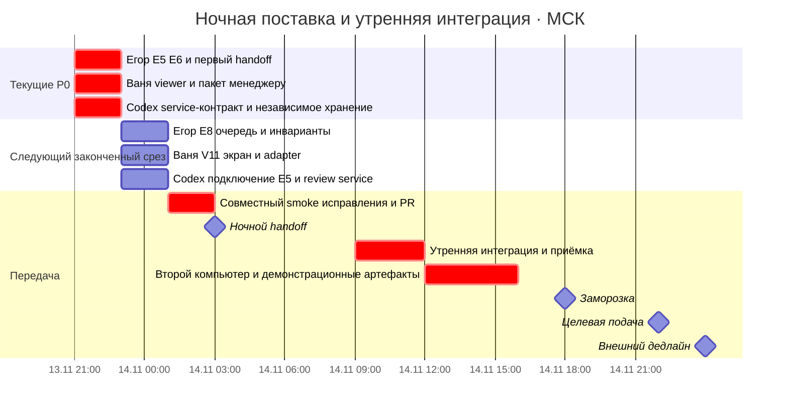

# Ночная очередь 13 → 14 ноября 2026

**Новая поставка во время планирования (13 ноября, 20:29 МСК):** появился [PR №8](https://github.com/GrigoryPislegin/hackathon-phystech-nanimai/pull/8), head `dd5862c`, E5 (1/2): политика v2, схемы профиля/условий и fixtures. Это проверено по GitHub-описанию, код/заявленные 148 тестов здесь ещё не принимались. Расчёт v2 остаётся следующей работой Егора; подключение схем — Codex. Повторять эту поставку не нужно.

**Назначено в GitHub:** [Егор E8 — #9](https://github.com/GrigoryPislegin/hackathon-phystech-nanimai/issues/9), [Ваня V11 — #10](https://github.com/GrigoryPislegin/hackathon-phystech-nanimai/issues/10), [Codex N-C — #11](https://github.com/GrigoryPislegin/hackathon-phystech-nanimai/issues/11). Текущие #7/#6 остаются первыми в очереди.

План подготовлен 13 ноября около 20:25 МСК по просьбе владельца поставить большие задачи после текущих. Проверенная кодовая база `ea1369f`, ветка `codex/cli-integration-consultation`, CI Repository checks success. `git ls-remote` на момент планирования не показал новых опубликованных веток E5/UI; это не утверждение, что ребята не работают локально.

## Что уже есть и чего ещё нет

Есть: CLI, четыре статуса, два synthetic replay, первый исторический Luna live на встроенном примере; подключённые E3/E4 и исправления парсеров; собственный privacy_core; 122 теста прототипа и 10 репозиторных проверок; Docker на Linux arm64 с публичными весами и mock SDK без сети. Эти результаты не являются измерением смысловой точности.

До сильной конкурсной поставки остаются:

| Пробел | Почему влияет на результат | Работа |
|---|---|---|
| Смысловое качество на frontend/учёте ОС/образовательном процессе | 24 балла сопоставления и части извлечения/ранжирования нельзя доказать тестами формата | Уже назначены E5/E6 и V6, не дублируем |
| Профиль для менеджера, условия и объяснение выбора | Эксперт назвал конкретный формат; generic Facts недостаточно | E5/E7 → интеграция Codex → V5 |
| Удобный реальный путь рекрутера | Пока нет опубликованного UI и запуска из него | V3/V5/V8 из #6, затем V11 |
| Подтверждение требований и решения человека | E4 существует, но нет действия/сохранения в приложении | E8 + N-C1 + V11 |
| Чистая поставка на другом компьютере | 20 баллов воспроизводимости требуют фактического запуска; CDN нестабилен | V7 + Codex release, до 16:00 14 ноября |
| Качество защиты и protected live | Pseudonymization может терять навыки/пропускать идентификаторы; mock не доказывает live | N-C3; платный запуск только отдельно разрешённый |
| Доказательства по рубрике и финальная демонстрация | Нужны артефакты и ограничения на конкретном SHA | Егор смысловая приёмка, Ваня запись/runbook, Codex общий пакет |

Отбор в топ-3 идёт по техническим 100 баллам. Это приоритет работы, не прогноз наших баллов. Сильный pitch поддержит продукт, но технический путь и доказательства нужно закончить до него.

## Что берём на ночь

**Единая цель:** получить опубликованный срез, где рекрутер открывает результат, понимает спорные места и сохраняет решение на конкретной версии; тот же отчёт можно снова открыть и передать менеджеру. Поддержать это смысловыми fixtures и проверкой без API.

| Владелец | Текущая обязательная поставка | Следующая большая задача | Первый независимый результат | Что можно отложить |
|---|---|---|---|---|
| Егор + Fable | E5 профиль/условия/политика, E6 ожидания; E7 объяснение | [E8: очередь и правила ручной проверки](team/tz-egor-night-2026-11-13.md) | DTO + чистая очередь + 2 fixtures | What-if и широкое редактирование фактов |
| Ваня | V3 viewer, V5 пакет, V6/V7 качество/доставка, доступный V8 | [V11: проверка и сохранённые результаты](team/tz-vanya-night-2026-11-13.md) | Экран/adapter с fake-service тестами; реальный viewer независим | Удаление до готового backend, декоративная доводка |
| Codex + Григорий | Подключить E5/E7 без конкурентной переписи | [N-C: service, хранение, review и интеграция](team/tz-codex-night-2026-11-13.md) | Конкретный service DTO + start/get/report и snapshot | Автоматический TTL, кеш LLM, распределённые worker-очереди |

Это очередь после текущих задач, не требование закончить оба больших пакета за одну ночь. У Егора/Вани уже есть #7/#6; они не закрываются автоматически. Незавершённые P0 входят в ночной объём первыми. WIP=1 крупная задача на человека, законченный малый PR каждые 60–90 минут по готовности.

## Контракты и точки синхронизации

1. E5 сначала публикует схему + 2 fixtures. Codex подключает её в model/pipeline; Ваня заранее готовит отображение с пустыми состояниями.
2. E8 публикует `review_queue`/`review_policy` как чистые функции. Backend подтверждает действия по своим snapshot/hash; UI не вычисляет право передачи.
3. Codex первым отдаёт Ване точную сигнатуру service adapter. UI может быть протестирован на fake service, но настоящая кнопка включается только после рабочего backend.
4. Подтверждение списка требований, статус модели, структурная проверка и решение HR — четыре разных состояния. Импортированный JSON не является доверенной историей сервера.
5. После интеграции общий synthetic smoke на одном SHA: complete, disputed, incomplete, stale; просмотр/review/export — 0 новых модельных вызовов.

Области файлов и конкретные приёмки находятся в трёх ТЗ. Никто не меняет чужой модуль параллельно. Изменение API публикуется отдельным коротким handoff, не исправляется молча в двух местах.

## Время и сокращение объёма

Доступность ребят по часам не измерена. Ниже контрольные ориентиры; в оценках каждой задачи 25–30% времени оставлено на проверки/стыковку. Ночь согласована просьбой владельца, но автоматическое выполнение агентами по расписанию этим документом не запускается.

В 00:00 оцениваем фактически опубликованное. Если E5 не сдан — E8 не вытесняет E5/E6; Ваня завершает viewer/print/приёмку, Codex независимое хранилище. Если к 02:00 нет общего backend — сдаём честный CLI + viewer + готовые adapter/тесты, запуск из браузера не объявляем выполненным. До 03:00 нужен handoff, а не огромная непроверенная ветка.

В расширение не входят ATS/HH, несколько кандидатов, OCR, обучение модели, мобильное приложение, несколько пользователей, рассылка, распределённая очередь и кеш чувствительных LLM-ответов. Их добавление сейчас не закрывает текущие критерии лучше, чем полноценный основной путь.

## Что показать утром

- Точный SHA каждой поставки и общий интеграционный SHA; файлы/команды/exit codes, список реальных зависимостей.
- Три режима отдельно: replay, настоящий SDK с mock transport, live. Отсутствующий live остаётся отсутствующим, не заменяется красивым названием.
- Готовый источник→профиль→рейтинг→цитаты→решение HR→менеджерский пакет либо точный список неподключённых шагов.
- Смысловые результаты на фиксированных cases: знаменатели, допустимые ответы, ошибки и нагрузка ручной проверки. Разметка команды — draft; не заявлять 100% качество рынка.
- Результат чистого запуска другого компьютера или воспроизводимый блокер. Runtime Python 3.13, собственный privacy_core; старые инструкции Certum не выполнять.

Ночью новые платные прогоны не обязательны и не разрешаются самим ТЗ. Для дальнейшего protected live понадобится отдельное разрешение на один синтетический прогон и лимит. Для реальных CV по-прежнему нужен ответ технического специалиста о внешней обработке. Ключ в чат не требуется.
