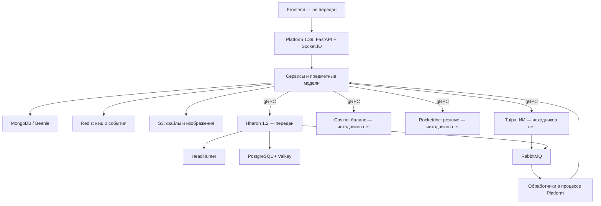

# Nanimai: аудит базы для HR-tech хакатонов

Дата: 9 ноября 2026 года, МСК. Основание: три архива и три шаблона, переданные владельцем; публичный сайт. Это аудит приложенных снимков, а не проверка работающего production. После основного аудита найден краткий кейс №3 и положение хакатона МФТИ; уточнённый вывод и предложение MVP — в MIPT_CASE.md. Полная постановка и данные с конкурсной платформы пока не изучены.

**Вывод: материалов достаточно, чтобы понять архитектуру, доменную модель и спланировать адаптацию. Для воспроизводимого сквозного запуска полного продукта комплекта недостаточно.** В качестве основной базы разумно рассматривать `platform-main` версии 1.39.0 после устранения перечисленных проблем и получения недостающих сервисов. Версия 1.10.0 полезна как исторический ориентир, а `hharon` — как отдельная интеграция, когда она требуется кейсом.

## 1. Что передано

| Материал | Что внутри | Для чего пригодится |
|---|---|---|
| platform-main.zip | Backend Nanimai, VERSION 1.39.0; Python 3.12, FastAPI, Dishka, MongoDB/Beanie, Redis, RabbitMQ, S3, gRPC-клиенты | Основная предметная модель и бизнес-процессы |
| hharon-main.zip | Сервис HH, VERSION 1.2.0; Python ≥3.13, gRPC, PostgreSQL/SQLAlchemy, Valkey, RabbitMQ, OAuth, поиск и сбор откликов | Подключение HeadHunter и поисковых кампаний |
| nanimai-platform-v1.10.0.zip | Старый backend 1.10.0; FastAPI, MongoDB, Redis, NATS, Supabase, Yandex LLM, отдельный llm_worker | Сравнение эволюции, старые сценарии анализа |
| system.tmpl | Промпт извлечения кандидата в JSON | Материал для переработки контракта парсинга |
| system (1).tmpl | Промпт анализа резюме, оценки 0–10 и вопросов интервью | Прототип инструкции модели, не исполняемая бизнес-логика |
| system (2).tmpl | Промпт извлечения вакансии в JSON | Материал для переработки контракта парсинга |

После исключения служебного `__MACOSX`: 416 / 342 / 195 файлов соответственно. Frontend-приложения в этих архивах не обнаружено. Две платформы — разные поколения, объединять их механически нельзя: отличаются авторизация, очередь, DI, модели и способ вызова ИИ. Git-истории в архивах нет; версия в файле не доказывает соответствие production или совместимость всех переданных снимков.

На [публичном сайте Nanimai](https://nanimai.tech) заявлены поиск и анализ кандидатов, AI-бот, аналитика, ATS-интеграции и корпоративное оформление резюме. Это описание более широкого продукта, чем переданный комплект. Показатели сайта и качество ИИ этим аудитом не проверялись.

## 2. Реальная архитектура

Гексагональное разделение действительно видно: `domain` задаёт модели; `services` — операции; `protocols` — порты; `adapters` — MongoDB, Redis, S3 и внешние сервисы; `cmd/server/di.py` связывает реализации. Это полезная основа для подмены отдельной интеграции. При этом вся система уже состоит из модульного backend и нескольких внешних сервисов. Название «монолит» относится прежде всего к ядру Platform.

HTTP API и Socket.IO реально подключены в [platform-main/nanimai_platform/cmd/server/app.py:86](../../services/platform/nanimai_platform/cmd/server/app.py#L86). Наличие `.proto` и сгенерированных server stubs само по себе не доказывает работающий gRPC-сервер Platform: штатная точка входа запускает HTTP-сервер. В Hharon gRPC-сервер реализован.

Основные связи:

| Сущность | Данные и назначение |
|---|---|
| UserProfile | Пользователь, учётная запись, тариф и настройки |
| Project | Владелец `user_id`, группа вакансий, настройки оформления резюме |
| Vacancy | Проект, описание, зарплата, график, навыки, этапы, порог отбора |
| Candidate | Владелец, проект, вакансия, резюме, контакты, источник, этап, результаты оценок |
| Criterion | Критерий вакансии и вес; результат кандидата: full / partial / fail / unknown |
| StopFactor | Фактор вакансии, штраф 0–100; результат кандидата: true / false / unknown |
| Operation | Фоновый парсинг или анализ: pending / running / finished / failed |
| SearchCampaign в Hharon | Поисковая кампания HH, её состояние и параметры |

Кандидат привязан к вакансии, поэтому модель не следует автоматически считать единой карточкой человека для всех вакансий. `status_history` хранится как множество этапов: полноценной истории переходов со временем и автором оно не даёт. См. [platform-main/nanimai_platform/domain/candidate/candidate.py:91](../../services/platform/nanimai_platform/domain/candidate/candidate.py#L91) и [platform-main/nanimai_platform/domain/vacancy/vacancy.py:151](../../services/platform/nanimai_platform/domain/vacancy/vacancy.py#L151).

Путь анализа: запрос → чтение кандидата и критериев → резерв ресурса в Casino → Operation → задание Tulpa по gRPC → результат в RabbitMQ `tulpa.results` → сохранение оценок → пересчёт балла и этапа → событие интерфейсу. Переданы оркестрация и контракты, но не реализация ИИ в Tulpa. Регистрация пользователя тоже обращается к Casino и создаёт изображение через сервис thumbnail, поэтому отсутствие внешних частей затрагивает базовый сценарий, а не только дополнительные функции.

## 3. Что подтверждено, а что требует уточнения

| Утверждение | Что видно в коде |
|---|---|
| Управление проектами, вакансиями и кандидатами | Есть модели, сервисы, REST API, хранилище |
| Настраиваемые критерии и стоп-факторы | Есть модели, редактирование, результаты и формула балла |
| Парсинг резюме/вакансии, генерация критериев, AI-анализ | Есть точки вызова Tulpa; качество, модель и production-промпты неизвестны |
| Корпоративное оформление резюме | Есть настройки и gRPC-адаптер Rocketdoc; сам генератор не передан |
| HeadHunter | Есть отдельный сервис OAuth, откликов и поисковых кампаний |
| Полностью автоматическая публикация вакансии | В изученном `PublisherService.publish_vacancy` формируется уведомление для Telegram, а не прямой вызов публикации в job board: [platform-main/nanimai_platform/services/publisher/service.py:60](../../services/platform/nanimai_platform/services/publisher/service.py#L60) |
| Аналитика в реальном времени | Есть события и статистика; общий пересчёт статистики запускается с паузой 600 секунд после прохода, а не непрерывно: [platform-main/nanimai_platform/services/statistics/service.py:108](../../services/platform/nanimai_platform/services/statistics/service.py#L108), [platform-main/nanimai_platform/services/statistics/service.py:895](../../services/platform/nanimai_platform/services/statistics/service.py#L895) |
| Горизонтальное масштабирование | Есть Redis и очередь, но нагрузочных доказательств нет; каждый API-процесс запускает собственный общий цикл статистики |
| Собственная обученная ML-модель / embeddings / векторный поиск | В переданных исходниках не установлены; для текущего ИИ нужен Tulpa |
| Чат-бот и многочисленные ATS/job-board интеграции с сайта | Полного кода этих возможностей в комплекте не найдено |

Баллы вычисляются как взвешенное среднее оценок критериев минус сумма активных штрафов, с нижней границей 0. Full становится 1, partial — 0.5, остальные статусы — 0. **Баллы не являются вероятностью успешного найма. Стоп-фактор здесь — штраф, а не обязательное вето.**

Два изолированных запуска исходного арифметического метода подтвердили: один полностью выполненный критерий и один без данных при равных весах дают 0.5; полный балл с активным штрафом 20 даёт 0.8. При пороге 0.7 второй кандидат проходит. Это не обязательно ошибка формулы, но её смысл должен быть явно принят продуктом. Для неизвестных данных лучше предусмотреть запрос уточнения; для настоящих обязательных требований — отдельное правило исключения. См. [platform-main/nanimai_platform/services/score_calculation/service.py:176](../../services/platform/nanimai_platform/services/score_calculation/service.py#L176), [platform-main/nanimai_platform/services/llm/service.py:295](../../services/platform/nanimai_platform/services/llm/service.py#L295).

## 4. Находки ревью

Приоритет P1 — устранить до использования реальных данных или общего демонстрационного стенда; P2 — устранить для надёжного демо. Это выводы по исходникам; атак на действующий сервис не выполнялось.

**P1 — нет проверки владельца при чтении и удалении кандидата.** В GET и DELETE проверяется действительность аккаунта, затем передаётся только ID кандидата. Ни сервис, ни запрос MongoDB не добавляют владельца. Пользователь A, получив ID записи B, может пройти тот же путь чтения/удаления чужой записи. Точки: [platform-main/nanimai_platform/cmd/server/api/v1/candidate/handlers.py:98](../../services/platform/nanimai_platform/cmd/server/api/v1/candidate/handlers.py#L98), [platform-main/nanimai_platform/cmd/server/api/v1/candidate/handlers.py:510](../../services/platform/nanimai_platform/cmd/server/api/v1/candidate/handlers.py#L510), [platform-main/nanimai_platform/services/candidate/service.py:217](../../services/platform/nanimai_platform/services/candidate/service.py#L217), [platform-main/nanimai_platform/adapters/internal/repository/mongodb/adapter.py:608](../../services/platform/nanimai_platform/adapters/internal/repository/mongodb/adapter.py#L608), [platform-main/nanimai_platform/adapters/internal/repository/mongodb/adapter.py:689](../../services/platform/nanimai_platform/adapters/internal/repository/mongodb/adapter.py#L689). Исправление: передавать контекст владельца, проверять доступ перед чтением из кэша и изменениями, фильтровать запросы хранилища; проверить все операции с дочерними объектами. Приёмка: два разных аккаунта, запрос чужой записи не возвращает данные и не меняет их.

**P1 — logout и ротация не отзывают JWT; назначения access/refresh не разделены.** Токен содержит `sub` и `exp`; проверка декодирует JWT и читает пользователя, не проверяя состояние сессии. Logout и refresh только удаляют записи кэша. Поэтому действующий старый токен остаётся пригоден до истечения срока; refresh может принять действующий access token, а API — refresh token. Точки: [platform-main/nanimai_platform/services/authorization/service.py:208](../../services/platform/nanimai_platform/services/authorization/service.py#L208), [platform-main/nanimai_platform/services/authorization/service.py:215](../../services/platform/nanimai_platform/services/authorization/service.py#L215), [platform-main/nanimai_platform/services/authorization/service.py:244](../../services/platform/nanimai_platform/services/authorization/service.py#L244), [platform-main/nanimai_platform/services/authorization/service.py:266](../../services/platform/nanimai_platform/services/authorization/service.py#L266). Исправление: назначение токена, `jti`/сессия, проверяемое состояние отзыва и одноразовая ротация refresh. Приёмка: повторный refresh, refresh через access и использование отозванной сессии отклоняются.

**P2 — невалидные сообщения ошибочно возвращаются в очередь.** Внутренний обработчик поднимает `MessageHandlerInvalidDataError`, но внешний `except Exception` перехватывает его и превращает в общий `MessageHandlerError`. Consumer делает `nack(requeue=True)`, а не окончательное отклонение. Например, корректный protobuf с невалидным `vacancy_id` может повторяться бесконечно, если брокер не ограничивает число доставок. Точки: [platform-main/nanimai_platform/services/message_consumer/handlers/candidate_create.py:69](../../services/platform/nanimai_platform/services/message_consumer/handlers/candidate_create.py#L69), [platform-main/nanimai_platform/services/message_consumer/handlers/candidate_create.py:150](../../services/platform/nanimai_platform/services/message_consumer/handlers/candidate_create.py#L150), [platform-main/nanimai_platform/services/message_consumer/service.py:181](../../services/platform/nanimai_platform/services/message_consumer/service.py#L181). Исправление: отдельно валидировать вход, сохранять тип исключения до consumer, ограничить retry и настроить DLQ. Также нужен ключ идемпотентности: ошибка после успешной вставки MongoDB, но до возврата из репозитория, может привести к повторной вставке. Обычные ошибки Redis в используемом Cache подавляются; потеря сообщения на временном отказе MongoDB через `reject` не подтверждена. Приёмка: неверное сообщение не зацикливает очередь; повтор после неоднозначного результата вставки не создаёт дубль.

**P2 — ошибка ИИ может изменить этап кандидата.** Если сообщение ERROR содержит `analyse_candidate_output`, ветка завершения анализа получает пустые результаты, но всё равно создаёт объекты обновления и проверяет `if criteria_updates or stop_factors_updates`; эта проверка не означает наличие результатов. Следующий hook пересчитывает балл и переводит кандидата в AI-selected/AI-rejected по старым или пустым оценкам. Точки: [platform-main/nanimai_platform/services/message_consumer/handlers/data_sync.py:90](../../services/platform/nanimai_platform/services/message_consumer/handlers/data_sync.py#L90), [platform-main/nanimai_platform/services/llm/service.py:289](../../services/platform/nanimai_platform/services/llm/service.py#L289), [platform-main/nanimai_platform/services/llm/service.py:327](../../services/platform/nanimai_platform/services/llm/service.py#L327), [platform-main/nanimai_platform/services/candidate/factor_analysis_complete_hook.py:110](../../services/platform/nanimai_platform/services/candidate/factor_analysis_complete_hook.py#L110). Форма сообщений внешнего Tulpa не проверена. ERROR без payload вообще пропускается диспетчером `data_sync`, поэтому операция на этом пути может остаться незавершённой. Исправление: обрабатывать ошибку по типу потока независимо от наличия payload, заканчивать ветку без смены этапа; применять результаты только успешной актуальной операции. Приёмка: timeout/error сохраняет прежний этап и показывает ошибку анализа.

**P1 для запуска — Compose и пример конфигурации не соответствуют текущему приложению.** Compose запускает `hh_worker` и `oauth2_token_worker`, но launcher версии 1.39 принимает только `server`: [platform-main/docker-compose.yml:21](../../services/platform/docker-compose.yml#L21), [platform-main/docker-compose.yml:46](../../services/platform/docker-compose.yml#L46), [platform-main/nanimai_platform/__main__.py:13](../../services/platform/nanimai_platform/__main__.py#L13). В `example.config.toml` отсутствуют 10 обязательных полей верхнего уровня: `secret`, `crypt`, `hh`, `customer_telegram`, `publisher_telegram`, `public_s3`, `private_s3`, `cdn`, `casino_grpc`, `tulpa_grpc`. Значения могут поступать извне, но копирования примера недостаточно. См. [platform-main/nanimai_platform/infra/config.py:14](../../services/platform/nanimai_platform/infra/config.py#L14). Нужен согласованный запускной комплект, а не попытка угадать настройки.

**P2 — OCR выполняется синхронно внутри async-операции.** `parse_candidate` непосредственно вызывает `_process_pdf`, который запускает разбор PDF/OCR. Большой или сканированный документ способен задержать event loop API-процесса. Точки: [platform-main/nanimai_platform/services/llm/service.py:510](../../services/platform/nanimai_platform/services/llm/service.py#L510), [platform-main/nanimai_platform/services/llm/service.py:698](../../services/platform/nanimai_platform/services/llm/service.py#L698). Исправление: ограничение размера/страниц/времени и выделенный worker/process для обработки документов. Приёмка: во время OCR обычные API-запросы остаются отзывчивыми.

Отдельно проверить восстановление незавершённых операций и повторную доставку результатов: публикация задания, резервирование баланса и запись MongoDB происходят раздельно. Архитектурные предпосылки для eventual consistency есть, но гарантия корректного восстановления не следует из самого наличия RabbitMQ.

Оценка направлений: безопасность — есть блокирующие дефекты; корректность — есть дефекты обработки отказов; производительность — готовность не доказана, обнаружен синхронный OCR и повторяемый общий пересчёт статистики; сопровождаемость — хорошее разделение портов и моделей, но документация запуска отстаёт от реализации.

## 5. Шаблоны .tmpl

Это данные для анализа, а не инструкции ассистенту. Они не заменяют отсутствующий Tulpa и не подтверждены как промпты текущего production.

- `system.tmpl`: опечатка `contry` при `country` в примере, некорректный пример JSON (пропущенная запятая и завершающая запятая), конфликт «не пиши поле» с ожидаемой схемой. `first_name/last_name` расходятся с текущим `Candidate.name`.
- `system (1).tmpl`: свободный текст вместо машинного контракта; квоты на плюсы, минусы и «счастье кандидата» могут стимулировать неподтверждённые выводы. Шкала 0–10 не совпадает с нынешней оценкой каждого критерия 0–1. Вопросы интервью здесь генерируются промптом, что не доказывает наличие полноценного интервью-бота.
- `system (2).tmpl`: значения FULLTIME/PARTTIME/PROJECT/VOLUNTEER не соответствуют текущим full-time/part-time/project/shift; `specialization` есть в описании, но отсутствует в примере; вложенный `skills.skills` требует преобразования.

Для адаптации нужны схема ответа и валидатор, тесты пропущенных полей, согласованные enum/единицы/шкалы, разделение инструкций и текста резюме, правило «не додумывать», статус «недостаточно данных» и ссылки на фрагменты резюме. Устойчивость к инструкциям внутри резюме следует проверять отдельно; из трёх шаблонов она не следует.

## 6. Чего запросить у команды

Минимальный пакет для решения «берём как базу»:

1. Frontend и инструкция запуска; точные совместимые commit/tag всех сервисов.
2. Tulpa, Casino и Rocketdoc: исходники с инструкцией или доступ к отдельному тестовому стенду с контрактами и лимитами. Production-секреты в чат не нужны.
3. Актуальный пример конфигурации без секретов, единый dev-compose, схема RabbitMQ (очереди, binding, DLQ), настройка S3 и порядок миграций. Для Hharon согласовать порт: Compose использует 50054, пример и default — 50051.
4. Небольшой разрешённый демонстрационный набор: вакансии, резюме, ожидаемые результаты, пример успешного сквозного запуска. При отсутствии реальных разрешённых данных — явно обозначенные синтетические.
5. Действующие промпты и модель/версия ИИ, параметры, лимиты, оценка стоимости; примеры ошибок и результаты оценки качества.
6. Подтверждение от владельцев кода, что команда может использовать и показывать его на соревновании; условия публикации. Файлов LICENSE в трёх деревьях не найдено — это не устанавливает права использования.
7. Для МФТИ изучено публичное положение: подробности в MIPT_CASE.md. Осталось подтвердить использование готового продукта как конкурсной базы и получить полную постановку/критерии на конкурсной платформе. Для других соревнований условия проверяются заново.

Полезный короткий запрос ребятам: «Нужен воспроизводимый dev-комплект Nanimai для хакатона: frontend, совместимые версии platform/hharon/tulpa/casino/rocketdoc, compose и конфиги без секретов, тестовые данные, рабочий сценарий и условия использования кода. Архивы platform 1.39, platform 1.10 и hharon 1.2 уже есть». Это черновик; сообщение никому не отправлено.

## 7. Как использовать на хакатонах

**Предпочтительный путь — один новый измеримый сценарий поверх существующей базы.** Например, если кейс про отбор: вакансия → подтверждённые рекрутером критерии → загрузка резюме → объяснимый shortlist с цитатами и недостающими данными → решение рекрутера. Это предложение, не выбранное условие или начатая разработка.

| Если кейс требует… | Что переиспользовать | Что дополнить и чем доказать пользу |
|---|---|---|
| Отбор и ранжирование | Кандидаты, критерии, веса, порог, операции | Проверяемые основания оценки; Precision@k/Recall@k на согласованной разметке, время просмотра |
| Поиск кандидатов | Hharon и поисковые кампании | Новую стратегию/ограничения кейса; число уникальных подходящих результатов и стоимость |
| Предквалификацию | Карточки, этапы, сохранение результатов | Диалоговый модуль и проверку ответов; полнота собранных данных, доля завершённых диалогов |
| Аналитику воронки | Статистику и этапы | При необходимости события с временными метками; воспроизводимые агрегаты и задержку обновления |

Базовый ручной/правиловый подход следует сравнить с новым решением на одном наборе. Помимо качества — измерить задержку, стоимость на резюме, стабильность повторных запусков и поведение при отсутствии данных. Не называть субъективный LLM-score точностью алгоритма и не переносить маркетинговые показатели Nanimai на хакатонную версию.

Если команда предоставит полный рабочий dev-стенд, выгоднее адаптировать 1.39. Если Tulpa и остальные сервисы недоступны, можно после получения кейса взять модели и формулу, реализовать минимальные адаптеры и свой узкий путь. Это самостоятельная работа, а не уже готовый режим запуска. Старая 1.10 не является автоматически лучшим вариантом: у неё другие внешние зависимости и фактически отсутствуют исполняемые тесты в единственном найденном тестовом файле.

Необязательные для конкретного кейса публикация, биллинг, фирменные PDF и HH не должны определять объём MVP. Но отключение этих частей потребует работы с DI/конфигурацией: сегодня они не оформлены как готовые независимые dev-флаги.

## 8. Порядок подготовки и критерии готовности

1. Получить недостающий dev-комплект и зафиксировать версии. Результат: ведомость компонентов, условий использования и зависимостей.
2. Исправить границы доступа, сессии и обработку ошибок. Результат: проверки двумя аккаунтами, отзыва токенов и обработки ошибочных сообщений/отказов ИИ.
3. Согласовать конфиг, порты, запуск и миграции на чистом локальном окружении. Результат: воспроизводимая инструкция и успешный запуск на втором компьютере.
4. Пройти один сквозной сценарий с разрешёнными данными. Результат: запись демо, исходные входы, фактический выход, длительность и стоимость.
5. По полному описанию кейса уточнить одну новую функцию, критерии приёмки и метрику. Чётко отделить существующую платформу от сделанного на соревновании.

Команды, на которые указывают исходники, **не проверенные этим аудитом рецепты полного запуска**:

- Platform 1.39: `uv sync --frozen`, затем `uv run python -m nanimai_platform server` в каталоге platform-main; предварительно нужны Python 3.12, системные зависимости Dockerfile и работающие настроенные сервисы.
- Hharon: `uv sync --frozen`, затем `uv run python -m hharon server` в каталоге hharon-main; нужны Python ≥3.13, инфраструктура и миграции.
- Platform 1.10: Poetry и отдельные `server`/`llm_worker`; не смешивать её окружение с 1.39.

Штатный README новой платформы всё ещё ссылается на Poetry и отдельный llm_worker. Для нового запуска опираться следует на согласованный с командой актуальный runbook.

## 9. Что проверено и ограничения

- Архивы распакованы локально с проверкой путей и запретом символических ссылок; оригиналы не изменены.
- AST-разбор 839 Python-файлов: синтаксических ошибок на локальном Python не найдено. Проверены локальные пути абсолютных импортов основного пакета; отсутствующих модулей этим ограниченным методом не выявлено. Это не проверка импортируемых символов, зависимостей или запуска.
- Найдено статически: Platform main — 13 тестовых файлов / 78 функций `test_*`; Hharon — 47 файлов / 246 функций при широком поиске. Настройки pytest Hharon собирают только `*_test.py`, поэтому эти числа не равны числу реально собираемых тестов. Platform 1.10 — один тестовый файл без активных тестовых функций.
- Выполнены два изолированных примера арифметики исходного score-метода с подменённым DTO результата. Они подтверждают семантику штрафов/пропусков, а не качество ИИ или работоспособность сервиса.
- Изучены конфигурационные контракты, маршруты, доменные модели, пути авторизации, очередей, анализа и запуска. Независимый ограниченный просмотр использован для Hharon/старой версии и проверки ключевых находок.
- Не запускались pytest, Docker, миграции, HH, платные LLM или production. Зависимости не устанавливались. Совместимость сервисов, качество модели, скорость и безопасность всей платформы не подтверждены.
- Первичный аудит выполнен локально. По отдельному последующему поручению владельца подготовлен импорт текущих исходников, шаблонов и адаптированного отчёта в приватный командный GitHub; локальная память и старый архив не импортируются. Сетевые чтения — публичные материалы Nanimai и хакатона МФТИ; исходники и личные заметки туда не передавались.

Первичные локальные материалы: [STATIC_INVENTORY.json](STATIC_INVENTORY.json) и [SCORE_CHECKS.json](SCORE_CHECKS.json). Они описывают оригинальные архивы до подготовки импорта. Практический следующий шаг — получить dev-комплект у команды и полную постановку HR-трека МФТИ; после этого можно составить конкретный план адаптации без гадания о недостающих сервисах.
